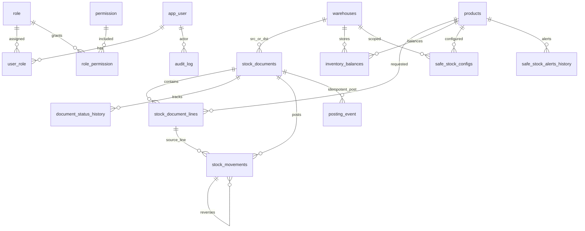

# [BE1] Thiết kế kiến trúc/ERD/giao dịch core/API

Traceability: `WWHN-150` | Parent Temp Key: `HN-TEC-001` | Epic Temp Key: `HN-EPIC-03` | Role: `BE1` | Output: `Architecture + OpenAPI core`

## 1. Mục tiêu và phạm vi

Thiết kế và xác minh lớp backend core cho WMS Hoa Nam: kiến trúc module, ERD nghiệp vụ kho, giao dịch nhập/xuất/chuyển kho, API v1, validation, RBAC, audit, idempotency và concurrency guard.

Phạm vi code đã đối chiếu:

- `Modules/Auth`: JWT auth, user/role/permission, middleware `permission:*`.
- `Modules/Warehouse`: master warehouse/SKU, inbound/outbound stock document, stock request, transfer order, stock ledger, inventory balance, safe stock, report/dashboard.
- `Modules/AuditLog`: audit append record cho thao tác nghiệp vụ quan trọng.
- `app/Support/IdempotencyStore.php`: idempotency dùng chung qua bảng `idempotency_keys`.
- `app/Http/Middleware/ApiConventionMiddleware.php`: chuẩn hóa envelope JSON, `X-Request-ID`, error code.
- `app/Swagger/OpenApi.php` và annotation controller: OpenAPI v1.

## 2. Kiến trúc backend

Backend dùng Laravel modular theo ranh giới nghiệp vụ:

- Controller nhận request, áp dụng `auth:api`, `permission:*`, FormRequest validation và trả response envelope.
- Service chứa business transaction, state machine và audit.
- Ledger là lớp duy nhất được phép làm thay đổi tồn kho thật.
- Repository chỉ dùng cho các CRUD/read model nơi đã có pattern sẵn.
- Migration định nghĩa schema, unique/index, FK và guard dữ liệu nền.

Luồng request chuẩn:

`HTTP API -> ApiConventionMiddleware -> auth:api -> permission middleware -> FormRequest -> Controller -> Service -> DB::transaction -> Model/DB -> Audit/Idempotency -> JSON envelope`

Quy ước response:

```json
{
  "success": true,
  "message": "Thành công",
  "data": {},
  "meta": {
    "request_id": "uuid-or-client-request-id",
    "timestamp": "2026-08-02T..."
  }
}
```

Lỗi không trả stack trace khi `APP_DEBUG=false`; error body chuẩn gồm `success=false`, `error_code`, `errors`, `error.code`, `meta.request_id`.

## 3. ERD core

Các bảng core đã có migration:

- `app_user`, `role`, `permission`, `user_role`, `role_permission`, `refresh_tokens`.
- `warehouses`, `products`.
- `stock_documents`, `stock_document_lines`, `document_status_history`, `document_status_transitions`.
- `inventory_balances`, `stock_movements`, `inventory_reservations`, `in_transit_ledger`, `inventory_report_snapshots`.
- `safe_stock_configs`, `safe_stock_alerts_history`.
- Extension/domain tables: `product_categories`, `uoms`, `suppliers`, `items`, `physical_codes`, `putaway_tasks`, `scan_batches`, `scan_events`, `stocktake_*`, `warranty_*`, `posting_event`, `reversal_documents`.
- `audit_log`, `idempotency_keys`.

Quan hệ chính:



## 4. Giao dịch core

### 4.1 Inbound document

State machine:

`draft -> pending -> approved -> received`

Nhánh partial:

`approved -> partially_posted -> received`

Nhánh đóng thiếu/hủy/đảo:

- `approved|partially_posted -> closed`
- `draft|pending|approved -> cancelled`
- `pending -> rejected`
- `received|closed -> reversed`

Rule chính:

- Tạo/sửa không làm đổi tồn kho.
- `post-receipt` tăng tồn cho toàn bộ line, bắt buộc `Idempotency-Key`.
- `scan` validate/classify va cap nhat `stock_document_lines.scanned_qty` only; `stock_effect=NONE`, khong ghi `stock_movements`, khong doi `inventory_balances`, khong doi trang thai chung tu.
- `close-remainder` ghi shortage trên line còn thiếu, không đổi tồn.
- `reverse` tạo movement đảo, tham chiếu `original_movement_id`.

### 4.2 Outbound document

State machine:

`draft -> pending -> approved -> issued`

Nhánh partial:

`approved -> partially_posted -> issued`

Rule chính:

- `approve` kiểm tra tồn khả dụng trước.
- `post-issue` giam ton that qua `StockLedger`.
- `scan` validate/classify va cap nhat `stock_document_lines.scanned_qty` only; `stock_effect=NONE`, khong ghi `stock_movements`, khong doi `inventory_balances`, khong doi trang thai chung tu.
- Không cho tồn âm; lỗi nghiệp vụ trả `INSUFFICIENT_STOCK`.
- `reverse` cộng trả lại tồn bằng movement đảo.

### 4.3 Transfer order

API transfer đã expose theo state riêng:

`draft -> pending -> approved -> in_transit -> completed`

Các nhánh hỗ trợ: `reject`, `cancel`, `record-loss`, `return`, `confirm-return`, `completed_with_loss`, `returned`. Vì baseline hiện tại nhấn mạnh kho tổng, transfer chỉ dùng khi có ít nhất 2 kho khác nhau và giữ ranh giới riêng trong `TransferService`.

## 5. Idempotency, concurrency và audit

Idempotency:

- Header chuẩn: `Idempotency-Key`.
- Khóa logic: `(idem_key, operation, user_id)`.
- Payload hash: `fullUrl|method|body`.
- Retry cùng key/payload trả lại response 2xx đã lưu.
- Cùng key nhưng payload khác trả `409 IDEMPOTENCY_ERROR`.
- Chỉ cache response 2xx; 4xx được phép sửa payload/quyền rồi gọi lại.
- Action bat buoc key: `post-receipt`, `post-issue`, `reverse`.
- `scan` khong bat buoc `Idempotency-Key`; neu client gui header du thi backend bo qua vi scan khong doi ton va khong ghi idempotency cache/posting event.
- Action create inbound/outbound cho phép key tùy chọn để chống double-click tạo phiếu.

Concurrency:

- `inventory_balances` được `lockForUpdate()` theo `(warehouse_id, product_id)`.
- Có optimistic guard bằng cột `version`.
- `stock_movements.business_key` chống ghi movement trùng cho full post/reverse.
- `stock_movements` append-only ở tầng Eloquent, không cho update/delete.

Audit:

- `AuditLogger::record()` được gọi ở các action quan trọng: create, approve, post, cancel, reverse.
- `document_status_history` lưu chuyển trạng thái và người thao tác.
- `posting_event` lưu event hạch toán đã commit theo operation/idempotency key.

## 6. API contract v1

Base URL local: `/api/v1`

Header chung:

- `Authorization: Bearer <jwt>`
- `X-Request-ID: <optional-client-request-id>`
- `Idempotency-Key: <required for post-receipt/post-issue/reverse only>`

Nhóm endpoint core:

| Nhóm | Endpoint chính | Permission |
| --- | --- | --- |
| Auth | `POST /auth/login`, `/auth/refresh`, `/auth/logout`, `GET /auth/me` | authenticated |
| Warehouse | `GET /warehouses`, `GET /warehouses/{id}`, `PATCH /warehouses/{id}` | `warehouse.view`, `warehouse.manage` |
| SKU/Product | `GET/POST /products`, `GET /products/{id}`, `PATCH /products/{id}/enable|disable`, `POST /skus/import-excel` | `sku.manage` |
| Inbound | `GET/POST /inbound-documents`, `PATCH /{id}`, `POST /submit|approve|reject|cancel|post-receipt|scan|close-remainder|reverse` | `stock_document.*` |
| Outbound | `GET/POST /outbound-documents`, `PATCH /{id}`, `POST /submit|approve|reject|cancel|post-issue|scan|close-remainder|reverse` | `stock_document.*` |
| Inventory | `GET /inventory/balances`, `GET /stock-movements`, `GET /stock-movements/{id}/trace-source` | `inventory.view` |
| Safe stock | `GET/POST/PATCH/DELETE /safe-stock-configs`, `GET /safe-stock-alerts` | `safe_stock.*` |
| Stock request | `GET/POST/PATCH/DELETE /stock-requests`, `POST /submit|approve|reject|convert|cancel` | `stock_request.*` |
| Transfer | `GET/POST/PATCH /transfer-orders`, `POST /submit|approve|reject|cancel|dispatch|receive|record-loss|return|confirm-return` | `transfer.*` |
| Report | `GET /reports/inventory-xnt`, `GET /reports/inventory-xnt/export-excel`, `GET /reports/dashboard-quick` | `report.view` |
| Audit | `GET /audit-logs` | audit permission |

OpenAPI source:

- Global metadata/security/tags: `app/Swagger/OpenApi.php`.
- Endpoint annotations: controllers under `Modules/*/app/Http/Controllers`.
- Generated artifact currently present: `storage/api-docs/api-docs.json`.

## 7. Validation và error code

Validation dùng FormRequest cho payload tạo/sửa chính:

- `StoreInboundDocumentRequest`, `UpdateInboundDocumentRequest`.
- `StoreOutboundDocumentRequest`, `UpdateOutboundDocumentRequest`.
- `StoreStockRequestRequest`, `UpdateStockRequestRequest`.
- `StoreTransferRequest`, `UpdateTransferRequest`.
- `StoreProductRequest`, safe stock requests.

Error code quan trọng:

| HTTP | Code | Khi dùng |
| --- | --- | --- |
| 400 | `MALFORMED_JSON`, `BAD_REQUEST` | JSON sai format hoặc request sai cú pháp |
| 401 | `UNAUTHENTICATED` | thiếu/sai JWT |
| 403 | `ACCESS_DENIED` | thiếu permission |
| 404 | `RESOURCE_NOT_FOUND` | không tìm thấy resource |
| 409 | `STATE_CONFLICT`, `IDEMPOTENCY_ERROR`, `DUPLICATE_RESOURCE` | sai trạng thái, key idempotency conflict, trùng unique |
| 422 | `BUSINESS_RULE_ERROR`, `INSUFFICIENT_STOCK` | rule nghiệp vụ/validation không đạt |
| 428 | `PRECONDITION_REQUIRED` | thiếu `Idempotency-Key` ở action bắt buộc |
| 500 | `INTERNAL_SERVER_ERROR` | lỗi hệ thống đã được envelope hóa |

## 8. Cập nhật code trong WWHN-150

Các chỉnh sửa đã thực hiện để hoàn thiện contract/evidence:

- Sửa `Modules/Warehouse/routes/api.php`: thêm import `Modules\Warehouse\Http\Controllers\ImportController` để route `POST /api/v1/skus/import-excel` resolve đúng controller khi chạy `route:list`/OpenAPI scan.
- Sửa `Modules/Warehouse/app/Http/Controllers/ReportController.php`: report/dashboard kỳ nghiệp vụ dùng `stock_documents.doc_date` thay vì `stock_movements.occurred_at`, bảo đảm `from_date/to_date` phản ánh ngày chứng từ và khớp dữ liệu FE/QA nhập.

## 9. Evidence kiểm thử

Đã chạy ngày 2026-08-02:

```text
php artisan test --filter=StockDocumentIdempotencyTest
Result: passed, 14 tests, 82 assertions
Note: PHPUnit cảnh báo không ghi được .phpunit.result.cache do permission sandbox, không ảnh hưởng kết quả test.
```

```text
php artisan route:list --path=api/v1
Result: passed, hiển thị 104 routes
Evidence chính: route /api/v1/skus/import-excel resolve về Modules\Warehouse\Http\Controllers\ImportController@importExcel.
```

## 10. Bàn giao FE/QA/BE2

FE1 nhận đủ:

- Endpoint/payload/error code trong OpenAPI annotation và bảng API contract ở trên.
- Header bắt buộc cho write action đổi tồn: `Idempotency-Key`.
- Response envelope chuẩn có `success`, `message`, `data`, `meta.request_id`.

QA nhận đủ:

- Test evidence core stock document/idempotency/report.
- Quy tắc state machine, error code và permission để viết scenario UAT.
- Dữ liệu DB evidence có thể kiểm qua `inventory_balances`, `stock_movements`, `document_status_history`, `posting_event`, `audit_log`.

BE2 nhận đủ:

- Ranh giới transaction: service mở `DB::transaction`, ledger chỉ mutate tồn bên trong transaction.
- Report kỳ nghiệp vụ bám theo `stock_documents.doc_date`.
- Concurrency guard nằm ở `InventoryBalance::lockForUpdate()` + `version`.

Không còn blocker thuộc phạm vi BE1 tại thời điểm cập nhật tài liệu này.

## 11. BE1 remediation P0/P1 - 2026-08-02

Tai lieu chinh muc 4/5 da duoc sua truc tiep: scan la validate/classify/update scanned state only; khong con mau thuan ve ton kho.

### BE1-P0-01 - Scan stock_effect=NONE

Da sua code:

- Removed `StockLedger::scanReceipt()`, `StockLedger::scanIssue()` va `scanKey()`. Scan khong con entrypoint nao de tao `stock_movements`.
- `StockDocumentService::validateScanLine()` chi validate va cap nhat `stock_document_lines.scanned_qty`.
- Response scan tra `stock_effect=NONE`, `movement_created=false`, `scanned_qty_before`, `scanned_qty_after`, `remaining_qty`.
- Scan inbound/outbound khong update `inventory_balances`, khong tao `posting_event`, khong doi status chung tu.
- Cac action duy nhat lam doi ton trong BE1: `post-receipt`, `post-issue`, `reverse`; `apply-adjustment` thuoc stocktake boundary rieng.

### BE1-P0-02 - OpenAPI/Postman artifact

Artifact that:

- OpenAPI JSON: `storage/api-docs/api-docs.json`
- OpenAPI version: `1.0.0` trong `app/Swagger/OpenApi.php`
- Contract changelog: `docs/api-contract/WMS_HoaNam_OpenAPI_Changelog_BE1.txt`
- Postman collection regenerated from OpenAPI: `docs/postman/WMS_HoaNam API Contract - DEV.postman_collection.json`
- Swagger local URL: `http://localhost:8080/api/documentation` khi chay app voi Docker/local server.

Hashes:

- `storage/api-docs/api-docs.json` SHA256 `0CEF303547C84FF966B7A507901102C10CF35E31CAFCE21620B8B3765B2A7816`
- `docs/postman/WMS_HoaNam API Contract - DEV.postman_collection.json` SHA256 `99AC1D2BA81D646E56B78B2DF998F4277BF30B85704C048486AFB9D90D0A52DD`
- `docs/api-contract/WMS_HoaNam_OpenAPI_Changelog_BE1.txt` SHA256 `90EF8276DDDB22EEFB00E2E935667C702A8BE5338D2441E061EA7FE0B94A18F3`

### BE1-P1-01 - Test/build evidence

Environment:

- Date/time: 2026-08-02 Asia/Saigon
- Commit before local changes: `81e20ee2a9092a93619c217b55293a563a056564`
- PHP/Laravel test runner: `php artisan test`
- DB evidence: RefreshDatabase test DB, direct assertions against `inventory_balances`, `stock_movements`, `posting_event`.

Raw command evidence:

```text
php artisan test --filter=StockDocumentIdempotencyTest
Result: passed, 14 tests, 98 assertions
Warning: PHPUnit could not write .phpunit.result.cache because of sandbox permission; test result passed.
```

```text
php artisan test --filter=StockDocumentCanonicalFlowTest
Result: passed, 11 tests, 109 assertions
Warning: PHPUnit could not write .phpunit.result.cache because of sandbox permission; test result passed.
```

```text
php artisan route:list --path=api/v1
Result: passed, 105 routes
New evidence route: GET /api/v1/reports/inventory-reconciliation -> ReportController@inventoryReconciliation
```

### BE1-P1-02 - QA1 review constraints

QA1 review scope theo OpenAPI artifact hash o tren:

- 403: route middleware map dung permission catalog, thieu permission tra `ACCESS_DENIED`.
- 409: sai state machine/idempotency conflict/optimistic conflict.
- 422: validation/business rule, bao gom over-scan qua `remaining_qty` va outbound insufficient stock.
- Idempotency: bat buoc voi `post-receipt`, `post-issue`, `reverse`; khong bat buoc voi scan vi scan khong doi ton.
- Race/rollback: stock mutation chi qua `StockLedger::mutate()` trong `DB::transaction()`, `lockForUpdate()` va `inventory_balances.version`.
- Reconciliation: dung `GET /api/v1/reports/inventory-reconciliation`.

### BE1-P1-03 - BE2 schema/domain boundary

Boundary da xac nhan trong code:

- BE1 so huu `stock_documents`, `stock_document_lines`, `inventory_balances`, `stock_movements`, `document_status_history`, `posting_event`.
- BE2/report/warranty/PV khong duoc tao nguon ton rieng lech BE1.
- Warranty temp-only va scan/classify khong tao stock movement.
- Stocktake adjustment la boundary rieng: neu apply adjustment thi phai tao movement approved, khong sua truc tiep balance/ledger.

### BE1-P1-04 - FE sign-off dependency

FE chi sign-off sau khi dung contract artifact:

- OpenAPI SHA256 `0CEF303547C84FF966B7A507901102C10CF35E31CAFCE21620B8B3765B2A7816`
- Postman SHA256 `99AC1D2BA81D646E56B78B2DF998F4277BF30B85704C048486AFB9D90D0A52DD`
- FE scan UI phai doc `stock_effect=NONE`, `movement_created=false`, `remaining_qty`; khong duoc cap nhat ton local sau scan.
- FE route permission cho reconciliation dung `report.view`.

### BE1-P1-05 - Permission/RBAC catalog

Permission catalog artifact:

- Path: `docs/permissions/WMS_PERMISSION_CATALOG_BE1.txt`
- SHA256 `FDE61B25D2019731522FAA4753DC071D5B41526A5BD2C24B79C8570D7A635C7E`
- Seed source: `Modules/Auth/database/seeders/AuthDatabaseSeeder.php`
- Route source: `Modules/Warehouse/routes/api.php`, `Modules/AuditLog/routes/api.php`, `Modules/Auth/routes/api.php`

### BE1-P1-06 - Reconciliation/ledger

Da bo sung:

- Route: `GET /api/v1/reports/inventory-reconciliation`
- Permission: `report.view`
- SQL logic: compare `inventory_balances.on_hand_qty` voi `SUM(stock_movements.qty_delta)` theo `(warehouse_id, product_id)`.
- Output: `summary.rows_checked`, `summary.mismatch_count`, `summary.status`, `rows`, `mismatches`, `delta_qty`, `mismatch_reason`, `expected_resolution`.
- Mismatch handling: khong sua `stock_movements` append-only; dieu tra missing `OPENING/backfill/POST/REVERSE/ADJUST` movement va repair bang adjustment approved.
- Test evidence: `StockDocumentIdempotencyTest` assert reconciliation `PASS` sau luong post-receipt that.

## 12. P0/P1 closure evidence - 2026-08-02 rerun

### BE1-P0-01 closed

Tai lieu chinh da duoc sua truc tiep tai muc 4.1/4.2/5/6:

- Scan inbound/outbound chi validate/classify/update scanned state.
- Scan response: `stock_effect=NONE`, `movement_created=false`.
- Scan khong ghi `stock_movements`, khong doi `inventory_balances`, khong tao `posting_event`, khong ghi `idempotency_keys`.
- Cac action BE1 duy nhat doi ton: `post-receipt`, `post-issue`, `reverse`.
- `apply-adjustment` la boundary stocktake rieng, phai tao movement adjustment approved; khong sua truc tiep balance.

Code guard:

- `Modules/Warehouse/app/Http/Controllers/Concerns/InteractsWithStockDocuments.php`: `scan()` chi goi `StockDocumentService::validateScanLine()`, khong goi `IdempotencyStore`.
- `Modules/Warehouse/app/Services/StockDocumentService.php`: `validateScanLine()` chi lock line, validate qty/stock availability, update `scanned_qty`, tra `stock_effect=NONE`.
- `Modules/Warehouse/app/Services/StockLedger.php`: khong co entrypoint scan mutation; ledger mutation chi qua inbound/outbound/transfer/reverse.
- `tests/Feature/StockDocumentIdempotencyTest.php`: assert scan co gui du `Idempotency-Key` van khong tao movement/posting_event/idempotency cache.

### BE1-P1 artifact/hash closure

Immutable source commit before local remediation:

- Commit SHA: `9fa64ef3f8878060cdff5be0053102ef8d8a0db2`

API artifacts:

- OpenAPI JSON: `storage/api-docs/api-docs.json`
- OpenAPI SHA256: `0CEF303547C84FF966B7A507901102C10CF35E31CAFCE21620B8B3765B2A7816`
- Postman collection: `docs/postman/WMS_HoaNam API Contract - DEV.postman_collection.json`
- Postman SHA256: `99AC1D2BA81D646E56B78B2DF998F4277BF30B85704C048486AFB9D90D0A52DD`
- Contract changelog: `docs/api-contract/WMS_HoaNam_OpenAPI_Changelog_BE1.txt`
- Changelog SHA256: `90EF8276DDDB22EEFB00E2E935667C702A8BE5338D2441E061EA7FE0B94A18F3`

Permission/RBAC artifacts:

- Permission catalog: `docs/permissions/WMS_PERMISSION_CATALOG_BE1.txt`
- Permission catalog SHA256: `FDE61B25D2019731522FAA4753DC071D5B41526A5BD2C24B79C8570D7A635C7E`
- Seed source: `Modules/Auth/database/seeders/AuthDatabaseSeeder.php`
- Route source: `Modules/Warehouse/routes/api.php`, `Modules/AuditLog/routes/api.php`, `Modules/Auth/routes/api.php`
- Test guard: `BackendMigrationSeedHealthTest::test_seeded_permission_catalog_covers_be1_routes_and_roles`
- FE ROUTE_PERMISSIONS confirmation required: scan routes use `stock_document.scan`; reconciliation route uses `report.view`; FE must not mutate local stock after scan.

Raw evidence logs attached in repo:

- `docs/evidence/be1/db-before-after-reconcile-evidence.md`
  - SHA256: `440CC1C3284B9E67935C5D86FF1EE37210E05E695E7CD9D2A3DEFB81F8034B4A`
  - Content: DB before-after and reconciliation output evidence backed by direct test assertions.

- `docs/evidence/be1/php-artisan-test-StockDocumentIdempotencyTest.log`
  - SHA256: `B2F20761D868F2B17821C9738119579F529D1D994102CAAAF37DBB63D8106D10`
  - Result: passed, 14 tests, 99 assertions.
- `docs/evidence/be1/php-artisan-test-StockDocumentCanonicalFlowTest.log`
  - SHA256: `E1FD5296C8AE72EA05FB279BB64328171D5BD5E8C19B208EF52D12B1E9291667`
  - Result: passed, 11 tests, 109 assertions.
- `docs/evidence/be1/php-artisan-test-BackendMigrationSeedHealthTest.log`
  - SHA256: `2EB6F1983854B2667BE60E9E9E81F108B6EDB6487321AA26534BC35C0589507C`
  - Result: passed, 6 tests, 76 assertions.
- `docs/evidence/be1/php-artisan-route-list-api-v1.log`
  - SHA256: `65792C59C9C5BC596706F6224F2551DBD3EE8B31F219D8CBCF201FABB2E78C96`
  - Result: passed, 105 routes.

QA1 handoff for WWHN-152:

- Review must use OpenAPI SHA256 above.
- 403 coverage: permission middleware and seeded role matrix.
- 409 coverage: state conflict and idempotency payload conflict.
- 422 coverage: validation/business rule, over-scan, insufficient stock.
- Race/rollback coverage: stock mutation only inside `DB::transaction()`, `lockForUpdate()`, optimistic `inventory_balances.version`; failed validation leaves no movement/balance mutation.
- Reconciliation coverage: `GET /api/v1/reports/inventory-reconciliation`, expected status `PASS` after canonical post flow.

BE2 handoff for WWHN-151:

- BE1 owns stock document, stock line, stock movement, inventory balance, posting event, status history.
- Report/warranty/PV must not create a separate stock source that bypasses BE1 ledger.
- Warranty `temp-only` and scan/classify do not create stock movement.
- Stocktake adjustment is the only separate adjustment boundary and must create approved `ADJUST_IN`/`ADJUST_OUT` style ledger movement.

FE handoff for WWHN-153:

- FE endpoint mapping must be based on OpenAPI SHA256 above.
- FE scan UI reads `stock_effect=NONE`, `movement_created=false`, `remaining_qty`.
- FE must not update displayed stock by scan response; refresh stock only after `post-receipt`, `post-issue`, `reverse`, or reconciliation/balance reads.
- FE permission map: inbound/outbound scan -> `stock_document.scan`; reconciliation -> `report.view`.
